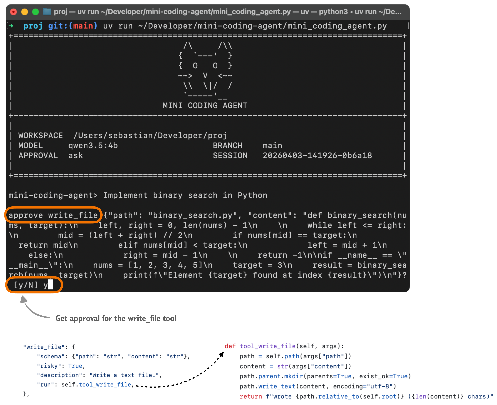
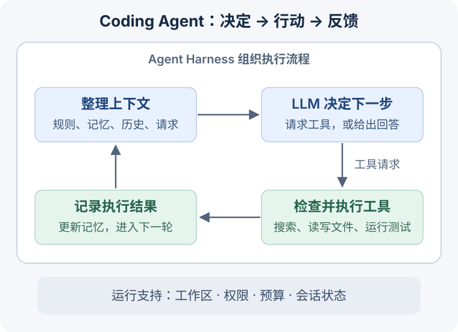
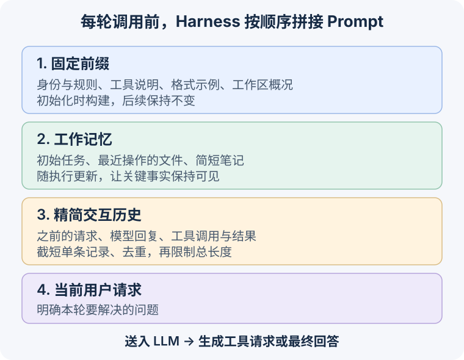

+++
date = '2026-10-21T12:00:00-07:00'
draft = false
title = 'Coding Agent 结构详解：Agent = LLM + Agent Harness'
tags = ['ai', 'aiagents', 'codingagent', 'llm', 'aicoding', '人工智能', 'AI编程']
summary = '从约 1,000 行 Python 的 Mini Coding Agent 出发，理解 Agent Loop、工具调用、上下文、记忆和子 Agent 如何协作，让 LLM 能够完成编程任务。'
+++

Coding Agent 正在改变我们开发软件的方式。你提出一个需求，它就能进行系统设计、查看和生成代码、修改文件、运行测试，再根据结果继续调整。这些神奇能力是怎样实现的？

核心是：**Agent = LLM + Agent Harness。** LLM 理解任务、决定下一步行动；Agent Harness 是围绕 LLM 构建的软件，负责准备输入、执行工具、保存状态，并控制执行边界。

Sebastian Raschka 的 [Mini Coding Agent](https://github.com/rasbt/mini-coding-agent/blob/717cae4ff10d01773bd12951f62a575825053414/mini_coding_agent.py) 用约 1,000 行 Python 展示了一个完整的 Coding Agent 的代码实现！很适合用来清晰理解 Agent 的原理和架构。本文基于我的理解，详解其架构与设计，并分享我的思考。

## 从一个编程任务看整体架构

以 Sebastian [原文](https://magazine.sebastianraschka.com/p/components-of-a-coding-agent)中的任务为例，用户输入：“Implement binary search in Python”（用 Python 实现二分查找）。围绕这个任务，Agent 可以这样工作：

1. 结合工作区信息理解需求，必要时阅读项目说明和已有代码。
2. 生成二分查找代码，请求调用工具 `write_file` 将其保存到 `binary_search.py`。Harness 检查请求，并按权限策略询问用户是否批准写入。
3. 文件写入后，请求调用工具 `run_shell` 运行示例或测试，获取实际执行结果。
4. 根据结果判断是否需要修改，再继续验证；完成后向用户说明实现和验证情况。



*图源：Sebastian Raschka，[Components of A Coding Agent](https://magazine.sebastianraschka.com/p/components-of-a-coding-agent)，Figure 9。*

**模型根据当前信息选择行动，Harness 把行动变成实际操作，再把结果交回模型。** 下图展示 Coding Agent 的架构和工作流程。



可以把它分成三层来理解：

| 层次 | 负责什么 |
| --- | --- |
| **LLM** | 理解需求，结合代码和工具结果推理，选择下一步行动或给出最终回答 |
| **Agent Loop** | 反复调用模型、执行工具、返回结果，直到结束或达到预算上限 |
| **运行支持** | 提供工作区信息、工具、权限检查、上下文整理和状态保存 |

这里一个重要的分工是：**LLM 生成“调用工具”的请求，真正读写文件、执行命令的是 Harness。**

## Agentic Loop

Mini Coding Agent 的核心循环位于 [`MiniAgent.ask()`](https://github.com/rasbt/mini-coding-agent/blob/717cae4ff10d01773bd12951f62a575825053414/mini_coding_agent.py#L445-L494)。它采用 ReAct 风格的流程：根据已有信息决定行动，获得环境反馈，再决定下一步行动。

把控制流程简化后，可以写成下面的伪代码：

```text
while within_tool_step_and_model_call_limits:
    response = call_llm(assemble_context())
    kind, payload = parse(response)

    if kind == "tool":
        result = validate_and_run_tool(payload)
        record_tool_result(payload, result)
        update_working_memory(payload, result)
    elif kind == "retry":
        record_formatting_feedback(payload)
    else:
        record_final_answer(payload)
        return payload

return report_limit_reached()
```

Harness 通过 `parse()` 解析 LLM 的输出，将后续处理分为三种情况：

- **工具请求：** 例如读取文件或运行 Shell 命令。Harness 检查并执行工具，将结果放入下一轮上下文，LLM 据此决定下一步行动。
- **格式重试：** 例如 LLM 生成了无法解析的 JSON。Harness 返回格式说明和正确格式例子，将这些反馈放入下一轮上下文，让 LLM 重试。
- **最终回答：** LLM 输出最终回答（Final Answer），Harness 记录并返回给用户，循环结束。

实现中有两种次数限制：`max_steps` 限制工具调用尝试次数，`max_attempts` 限制 LLM 调用总次数。达到任一上限时，Harness 都会停止循环并返回停止原因。

## 工具（Tool Use）：把 LLM 的决定变成实际操作

工具让 Agent 能够接触代码仓库和运行环境。Mini Coding Agent 提供了几类工具：

| 工具 | 用途 |
| --- | --- |
| `list_files`、`search`、`read_file` | 查找和阅读文件 |
| `write_file`、`patch_file` | 创建或修改文件 |
| `run_shell` | 执行命令，例如运行测试 |
| `delegate` | 将子任务交给一个受限的子 Agent |

很多 LLM API 原生支持 Tool Calling：调用时提供工具定义，LLM 以结构化形式返回工具名称和参数。

Mini Coding Agent 未使用这类 API，而是采用文本协议：在 Prompt 中说明工具名称、参数和输出格式，让 LLM 需要调用工具时生成这样的文本：

```xml
<tool>{"name":"read_file","args":{"path":"README.md","start":1,"end":80}}</tool>
```

`name` 指定工具，`args` 提供参数。**LLM 生成调用请求，Harness 执行实际操作。** 在这个例子中，Harness 解析并检查请求后，调用 Python 方法 `tool_read_file()`，读取 `README.md` 的第 1–80 行。

执行工具前，[`run_tool()`](https://github.com/rasbt/mini-coding-agent/blob/717cae4ff10d01773bd12951f62a575825053414/mini_coding_agent.py#L496-L515) 会检查工具名称和参数、拦截反复出现的相同调用，并按权限策略检查是否允许执行。执行后，再截短过长的输出。

工具结果、参数错误或命令失败信息，都会进入下一轮上下文。**错误也能提供有用的反馈，帮助 LLM 调整下一步行动。**

## 上下文：每一轮，LLM 到底看到了什么？

Agent 能连续工作，是因为 Harness 在每轮调用时，都会把相关信息整理进模型输入。这个实现的 [`prompt()`](https://github.com/rasbt/mini-coding-agent/blob/717cae4ff10d01773bd12951f62a575825053414/mini_coding_agent.py#L422-L429) 按固定顺序拼接四部分：



### 固定前缀：规则、工具和工作区信息

固定前缀相当于 Agent 的基本说明书，包含：

- **身份与规则：** 例如通过工具了解工作区，不要编造工具结果。
- **工具说明和格式示例：** 告诉模型有哪些工具、需要哪些参数，以及如何表达工具请求和最终回答。
- **工作区概况：** 仓库根目录、Git 分支与状态、近期提交，以及找到的 `AGENTS.md`、`README.md`、`pyproject.toml`、`package.json` 等文件的节选。

这个前缀在 Agent 初始化时构建，随后各轮调用保持不变。如果模型服务支持 Prompt 前缀缓存，这种结构有利于缓存复用。

也因此，其中的 Git 状态等信息是**启动时的快照**。任务执行后，若需要了解最新文件内容或仓库状态，仍应通过工具读取。

### 工作记忆：让关键事实保持可见

Working Memory 是一份简短的任务备忘，包含三个字段：

| 字段 | 内容 |
| --- | --- |
| `task` | 会话中首个用户请求的缩短版本，帮助保留初始目标 |
| `files` | 最近读取、创建或修改的文件路径，最多 8 个 |
| `notes` | 最近工具结果和最终回答的简短节选，最多 5 条 |

比如，修复解析器时，`files` 能提醒模型刚才检查了哪些文件，`notes` 能保留最近的测试反馈。它们让关键信息不必每次都从长篇历史中寻找。

这里的记忆由代码按规则更新，并没有额外调用 LLM 生成智能摘要。理解这一点，也就能看清这个小型实现的能力边界。

### 精简交互历史：保留经过，控制长度

随着执行推进，用户请求、模型回复、工具调用和工具结果会不断积累。如果每次都原样放入 Prompt，旧的代码片段和日志就可能占据大量空间。

[`history_text()`](https://github.com/rasbt/mini-coding-agent/blob/717cae4ff10d01773bd12951f62a575825053414/mini_coding_agent.py#L390-L417) 用三种方式控制历史长度：

1. **截短单条记录：** 近期记录保留更多内容，较早记录保留更少。
2. **省略重复读取：** 对较早历史中的重复文件读取做去重。
3. **限制总长度：** 拼接后，再限制整段历史的大小。

这是一种基于规则的精简。它降低了输入长度，但也可能省略重要细节；如果后续需要这些细节，Agent 可以再次读取文件或运行工具。

最后，Harness 再附上**当前用户请求**，明确这一轮要解决的问题。

## 状态保存与上下文，是两件相关但不同的事

上面讲的是“这次送给模型看什么”。另一个问题是：“程序中断后，之前的工作还能保留吗？”

[`SessionStore`](https://github.com/rasbt/mini-coding-agent/blob/717cae4ff10d01773bd12951f62a575825053414/mini_coding_agent.py#L146-L164) 把已记录的交互历史和工作记忆保存在 JSON 文件中，便于重新加载会话状态。

可以这样区分：

- **会话文件**保存记录和记忆，用于持久化与恢复。
- **模型上下文**是每次调用时整理出的视图，只包含固定前缀、工作记忆、精简历史和当前请求。

例如，历史记录中可能保存着某次工具输出；下一轮模型看到的，却只是它被截短后的内容。**保存了信息，不等于每次都把它完整送进模型。**

这种区分对长任务很重要：持久化解决状态保存，上下文管理决定有限的输入空间如何分配。

## 子 Agent：把调查工作委派出去

除了直接操作工具，模型还可以调用 `delegate`，例如：“找出导致解析器测试失败的函数。”

[`tool_delegate()`](https://github.com/rasbt/mini-coding-agent/blob/717cae4ff10d01773bd12951f62a575825053414/mini_coding_agent.py#L847-L866) 会创建一个子 Agent。它有自己的 Agent Loop，并获得完成任务所需的上下文：工作区信息、子任务描述，以及父 Agent 历史的一小段节选。

这个子 Agent 受到明确约束：

- 以只读方式调查，禁止文件修改。
- 有独立的工具步数上限。
- 受最大委派深度限制，避免无限创建下一层子 Agent。

父 Agent 等待它完成。子 Agent 的最终回答作为 `delegate` 的工具结果返回，进入父 Agent 的下一轮上下文，父 Agent 再决定如何继续。

这里的设计很自然：**把委派也做成工具，让模型根据任务决定何时需要帮助。** 这个实现展示的是受限的子任务委派；调用 `delegate` 本身并不意味着多个 Agent 已经在并行工作。

## 我的思考

### 小型实现，让架构更容易看清

我很喜欢这份代码的简洁。约 1,000 行 Python 就把循环、工具、上下文、记忆和委派串联起来，读者可以沿着一次请求追踪完整流程。

读懂它之后，再看更复杂的 Coding Agent，就更容易判断：哪些部分在调用模型，哪些在执行操作，哪些在管理状态。

### 上下文工程，决定模型如何使用已有信息

即使模型很强，Harness 仍然需要回答：哪些信息要反复提醒？哪些可以省略？历史要保留多少细节？工具输出应该多长？

这些选择影响模型能否抓住重点，也影响成本和延迟。这个实现用固定规则完成上下文管理，结构清楚，但规则也需要结合实际任务来调整。

我预期，随着模型能力提高、成本下降，更多上下文管理工作可以交给 LLM，例如压缩历史、维护记忆和选择相关信息。在有可靠评估机制的领域，这些方法更容易验证和改进。这是一个值得探索的方向。

### 增加子 Agent，能否带来更强的能力？

把委派作为工具，给了模型组织工作的空间。更通用的 Harness 可以沿着这个思路，支持多个 Agent 分工、递归委派和协调结果。

我的一个期待是：增加子 Agent 数量和总计算量，也许能帮助系统解决更复杂的问题。但能否形成稳定的 Scaling Law，仍需要研究和实验。

额外计算也会带来协调成本。因此，委派深度、Agent 数量、计算预算和权限边界，都需要随架构一起设计。

## 延伸阅读与致谢

如果想继续理解工具接口和反馈为什么会影响 Agent 的能力，可以阅读本站的 [SWE-agent 解读]()。关于 Workflow 与自主 Agent 的选择，也可以参考 [Anthropic：如何构建有效的 AI Agent]()。

感谢 [Sebastian Raschka](https://sebastianraschka.com/) 的 [Mini Coding Agent](https://github.com/rasbt/mini-coding-agent) 和 [Components of A Coding Agent](https://magazine.sebastianraschka.com/p/components-of-a-coding-agent)。这份小型实现，让 Coding Agent 的核心架构变得容易理解。

本文基于我的[英文原文](https://tiejun-ai.github.io/posts/coding_agent_architecture/)重新组织。伪代码和工具调用示例根据 Mini Coding Agent 改编，参考代码版本为 [`717cae4`](https://github.com/rasbt/mini-coding-agent/tree/717cae4ff10d01773bd12951f62a575825053414)，Copyright 2026 Sebastian Raschka，遵循 [Apache License 2.0](mini-coding-agent-LICENSE.txt)。中文示意图为本文绘制。
