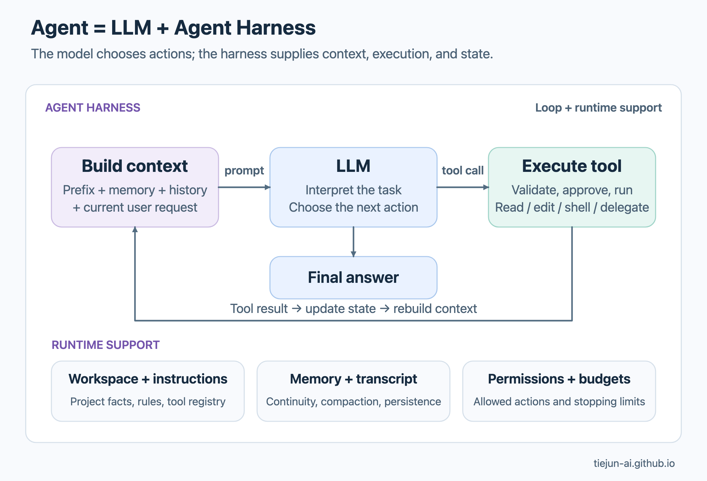
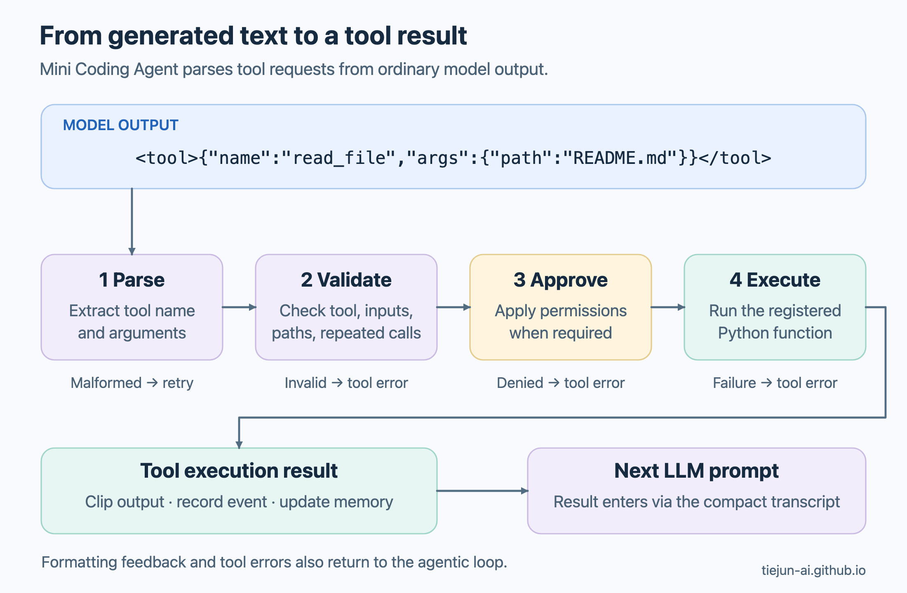
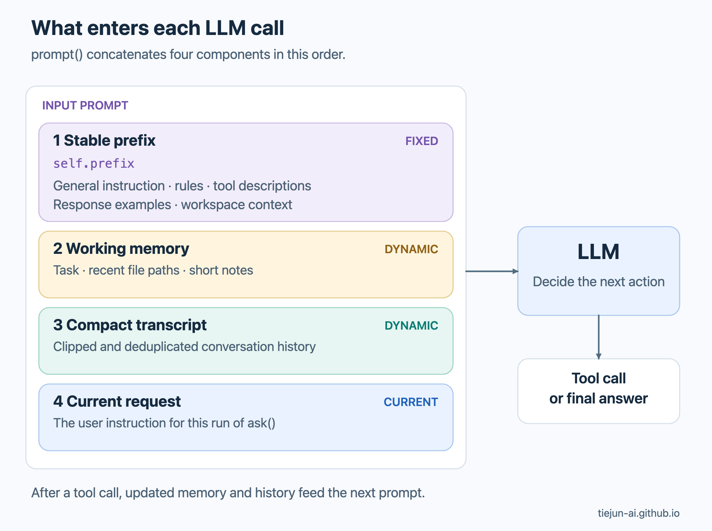
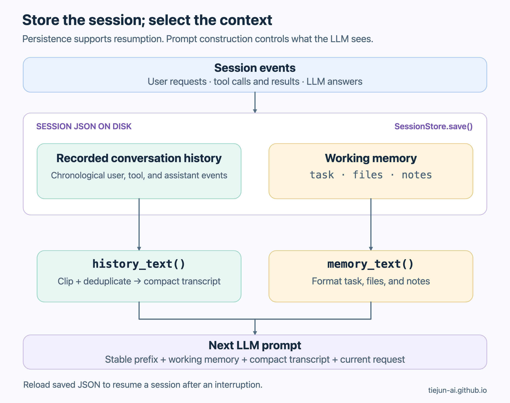
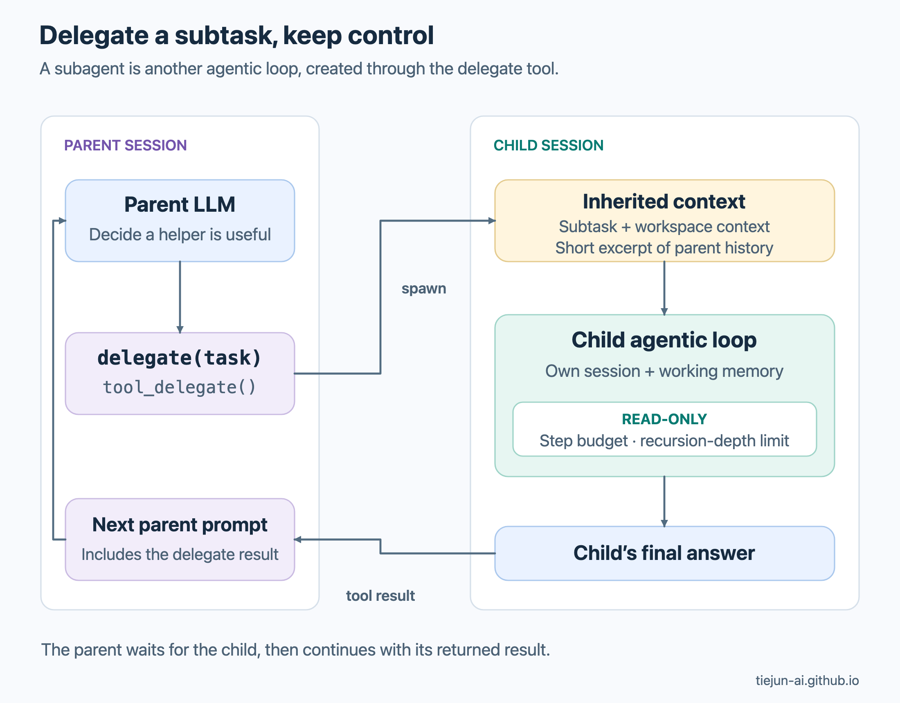

+++
date = '2026-10-21T12:00:00-07:00'
draft = false
title = 'Coding Agent 结构详解：Agent = LLM + Agent Harness'
tags = ['ai', 'aiagents', 'codingagent', 'llm', 'aicoding', '人工智能', 'AI编程']
summary = '从约 1,000 行 Python 的 Mini Coding Agent 出发，理解 Agent Loop、工具调用、Context Window、记忆和 SubAgent 如何协作，让 LLM 能够完成编程任务。'
+++

Coding Agent 正在改变我们开发软件的方式。你提出一个需求，它就能进行系统设计、查看和生成代码、修改文件、运行测试，再根据结果继续调整。这些神奇能力是怎样实现的？

核心是：**Agent = LLM + Agent Harness。** LLM 理解任务、决定下一步行动；Agent Harness 是围绕 LLM 构建的软件，负责准备输入、执行工具、保存状态，并控制执行边界。

Sebastian Raschka 的 [Mini Coding Agent](https://github.com/rasbt/mini-coding-agent/blob/717cae4ff10d01773bd12951f62a575825053414/mini_coding_agent.py) 用约 1,000 行 Python 展示了一个完整的 Coding Agent 的代码实现！很适合用来清晰理解 Agent 的原理和架构。本文基于我的理解，详解其架构与设计，并分享我的思考。

## 从一个编程任务看整体架构

以 Sebastian [原文](https://magazine.sebastianraschka.com/p/components-of-a-coding-agent)中的任务为例，用户输入：“Implement binary search in Python”（用 Python 实现二分查找）。围绕这个任务，Agent 可以这样工作：

1. 结合工作区信息理解需求，必要时阅读项目说明和已有代码。
2. 生成二分查找代码，请求调用工具 `write_file` 将其保存到 `binary_search.py`。Harness 检查请求，并按权限策略询问用户是否批准写入。
3. 文件写入后，请求调用工具 `run_shell` 运行示例或测试，获取实际执行结果。
4. 根据结果判断是否需要修改，再继续验证；完成后向用户说明实现和验证情况。


*图源：Sebastian Raschka，[Components of A Coding Agent](https://magazine.sebastianraschka.com/p/components-of-a-coding-agent)，Figure 9。*

**模型根据当前信息选择行动，Harness 把行动变成实际操作，再把结果交回模型。** 下图展示 Coding Agent 的架构和工作流程。



可以把它分成三层来理解：

| 层次 | 负责什么 |
| --- | --- |
| **LLM** | 理解需求，结合代码和工具结果推理，选择下一步行动或给出最终回答 |
| **Agent Loop** | 反复调用模型、执行工具、返回结果，直到结束或达到预算上限 |
| **Runtime Support** | Workspace Context, Tools, Permission Checks, Context Window Assembly, State Persistence |

这里一个重要的分工是：**LLM 生成“调用工具”的请求，真正读写文件、执行命令的是 Harness。**

## Agentic Loop

Mini Coding Agent 的核心循环位于 [`MiniAgent.ask()`](https://github.com/rasbt/mini-coding-agent/blob/717cae4ff10d01773bd12951f62a575825053414/mini_coding_agent.py#L445-L494)。它采用 ReAct 风格的流程：根据已有信息决定行动，获得环境反馈，再决定下一步行动。流程可以简化为如下伪代码：

```text
while within_tool_step_and_model_call_limits:
    response = call_llm(assemble_context())
    kind, payload = parse(response)

    if kind == "tool":
        result = validate_and_run_tool(payload)
        record_tool_result(payload, result)
        update_working_memory(payload, result)
    elif kind == "retry":
        record_formatting_feedback(payload)
    else:
        record_final_answer(payload)
        return payload

return report_limit_reached()
```

Harness 通过 `parse()` 解析 LLM 的输出，将后续处理分为三种情况：

- **工具请求：** 例如读取文件或运行 Shell 命令。Harness 检查并执行工具，将结果放入下一轮 Context Window，LLM 据此决定下一步行动。
- **格式重试：** 例如 LLM 生成了无法解析的 JSON。Harness 返回格式说明和正确格式例子，将这些反馈放入下一轮 Context Window，让 LLM 重试。
- **最终回答：** LLM 输出最终回答（Final Answer），Harness 记录并返回给用户，循环结束。

实现中有两种次数限制：`max_steps` 限制工具调用尝试次数，`max_attempts` 限制 LLM 调用总次数。达到任一上限时，Harness 都会停止循环并返回停止原因。

## 工具（Tool Use）：把 LLM 的决定变成实际操作

工具让 LLM 能够请求 Harness 搜索、读写代码及其他文件、运行 Shell 命令，以及创建 SubAgent。**LLM 生成调用请求，Harness 执行实际操作并返回结果。**

很多 LLM API 原生支持 Tool Calling：应用提供工具定义，LLM 在专门的响应字段中返回结构化的工具调用。

Mini Coding Agent 采用自己的文本协议，将工具说明和输出格式直接放入 Prompt。下面节选自 [`build_prefix()`](https://github.com/rasbt/mini-coding-agent/blob/717cae4ff10d01773bd12951f62a575825053414/mini_coding_agent.py#L333-L374)，展示它如何告诉 LLM 生成工具请求：

```text
Rules:
- Use tools instead of guessing about the workspace.
- Return exactly one <tool>...</tool> or one <final>...</final>.
- Tool calls must look like:
  <tool>{"name":"tool_name","args":{...}}</tool>

Tools:
- read_file(path: str, start: int=1, end: int=200) [safe] Read a UTF-8 file by line range.

Valid response examples:
<tool>{"name":"read_file","args":{"path":"README.md","start":1,"end":80}}</tool>
```

其中，`<tool>` 标记工具请求，`name` 指定工具，`args` 提供参数。[`parse()`](https://github.com/rasbt/mini-coding-agent/blob/717cae4ff10d01773bd12951f62a575825053414/mini_coding_agent.py#L616-L647) 从 LLM 生成的文本中提取这些信息。



*文本形式的工具请求经过检查后，才成为实际的 Python 调用。执行结果、错误和格式反馈都会返回 Agentic Loop。*

[`build_tools()`](https://github.com/rasbt/mini-coding-agent/blob/717cae4ff10d01773bd12951f62a575825053414/mini_coding_agent.py#L282-L328) 注册每个工具的参数定义、用途说明、审批标记和 Python 实现：

| 工具 | 用途 |
| --- | --- |
| `list_files`、`search`、`read_file` | 查找和阅读代码及其他文件 |
| `write_file`、`patch_file` | 创建或修改文件 |
| `run_shell` | 执行命令，包括运行测试 |
| `delegate` | 创建一个受限的 SubAgent |

[`run_tool()`](https://github.com/rasbt/mini-coding-agent/blob/717cae4ff10d01773bd12951f62a575825053414/mini_coding_agent.py#L496-L515) 负责校验请求、检查重复调用、应用审批策略、执行工具，并截短过长的输出。执行结果或错误信息会通过 Compact Transcript 进入下一次 LLM 调用的 Context Window。

## Context Window：每一轮，LLM 到底看到了什么？

在 Agentic Loop 的每一轮中，LLM 都需要相关信息来决定下一步行动。Harness 将指令、工具说明、仓库信息、Working Memory、交互历史和 Current User Request 整理成输入 Prompt。



*`prompt()` 按固定顺序拼接四部分：Stable Prefix、Working Memory、Compact Transcript 和 Current User Request。*

[`prompt()`](https://github.com/rasbt/mini-coding-agent/blob/717cae4ff10d01773bd12951f62a575825053414/mini_coding_agent.py#L422-L429) 的代码直接展示了这一结构：

```python
def prompt(self, user_message):
    return "\n\n".join([
        self.prefix,
        self.memory_text(),
        "Transcript:\n" + self.history_text(),
        "Current user request:\n" + user_message,
    ])
```

| 组成部分 | 提供的信息 |
| --- | --- |
| **Stable Prefix** | 基本指令、规则、工具说明、工具调用与最终回答示例、工作区概况 |
| **Working Memory** | 任务、重要文件路径、简短笔记 |
| **Compact Transcript** | 之前的请求、工具调用及结果、LLM 回复 |
| **Current User Request** | 这一轮循环正在处理的用户指令 |

Stable Prefix 在会话的各轮调用中保持不变，Working Memory 和 Compact Transcript 则随执行更新。Harness 每轮都将拼接后的 Prompt 发送给 LLM。下面分别看这些部分如何构建。

### Stable Prefix：规则、工具和工作区信息

[`build_prefix()`](https://github.com/rasbt/mini-coding-agent/blob/717cae4ff10d01773bd12951f62a575825053414/mini_coding_agent.py#L333-L374) 按下面的方式构建 Stable Prefix：

```python
return "\n\n".join([
    "You are Mini-Coding-Agent, a small local coding agent running through Ollama.",
    "Rules:\n" + rules,
    "Tools:\n" + tool_text,
    "Valid response examples:\n" + examples,
    self.workspace.text(),
])
```

其中包含五类信息：

- **基本指令：** 说明 Agent 的身份和运行环境，例如通过 Ollama 运行的本地 Coding Agent。
- **规则：** 指导 LLM 的行为，规定工具调用和最终回答的输出格式。
- **工具说明：** 告诉 LLM 有哪些工具、各自的用途和参数。
- **格式示例：** 展示有效的工具调用和最终回答，让 LLM 有具体格式可以遵循。
- **Workspace Context：** 由 [`WorkspaceContext.build()`](https://github.com/rasbt/mini-coding-agent/blob/717cae4ff10d01773bd12951f62a575825053414/mini_coding_agent.py#L75-L143) 生成，包括仓库根目录、分支、Git 状态、近期提交，以及在根目录或当前目录找到的 `AGENTS.md`、`README.md`、`pyproject.toml`、`package.json` 等文件的节选。

Stable Prefix 在 Agent 启动时构建，后续各轮调用保持不变。如果 LLM 服务支持 Prompt Prefix Caching，这种稳定结构有利于缓存复用。

### Working Memory：让关键信息保持可见

会话开始时，Working Memory 的结构如下：

```json
"memory": {"task": "", "files": [], "notes": []}
```

三个字段分别保留不同的信息：

| 字段 | 内容 |
| --- | --- |
| `task` | 会话中首个用户请求的缩短版本，让初始目标在后续步骤中保持可见 |
| `files` | 最近读取、创建或修改的文件路径，帮助 LLM 跟踪正在处理的文件，最多保留 8 个 |
| `notes` | 工具执行结果和最终回答的简短节选，让近期结果保持可见，最多保留 5 条 |

### Compact Transcript：保留经过，控制长度

每轮调用时，LLM 都需要相关的交互历史，包括用户请求、LLM 回复、工具调用及其执行结果。Harness 通过 `"Transcript:\n" + self.history_text()` 将精简后的历史放入 Prompt，在保持任务连续性的同时控制输入长度。

每轮循环都会产生新的历史记录。[`history_text()`](https://github.com/rasbt/mini-coding-agent/blob/717cae4ff10d01773bd12951f62a575825053414/mini_coding_agent.py#L390-L417) 用三种方式精简这些记录：

1. **截短单条记录：** 近期记录保留更多内容，较早记录保留更少。
2. **省略重复读取：** 对较早历史中的重复文件读取做去重。
3. **限制总长度：** 拼接后，再限制整段历史的大小。

### SessionStore：保存交互历史和 Working Memory



*保存的历史记录和 Working Memory 分别服务于 Prompt 的不同部分。持久化保存会话状态，Prompt 构建决定 LLM 每次看到什么。*

[`SessionStore`](https://github.com/rasbt/mini-coding-agent/blob/717cae4ff10d01773bd12951f62a575825053414/mini_coding_agent.py#L146-L164) 将已记录的交互历史和 Working Memory 一起保存为 JSON 文件，便于在程序故障或中断后重新加载会话状态。

已保存的历史记录不会直接完整放入 Context Window。进入 Prompt 的是精简后的 Compact Transcript，以及 Working Memory 等其他组成部分。这样既能控制输入长度，也能让 LLM 更关注关键信息。

## SubAgent：把调查工作委派出去

Mini Coding Agent 允许 LLM 调用 `delegate` 工具来委派子任务，对应的实现是 [`tool_delegate()`](https://github.com/rasbt/mini-coding-agent/blob/717cae4ff10d01773bd12951f62a575825053414/mini_coding_agent.py#L847-L866)。例如，LLM 可以将一个调查任务交给 SubAgent：

```xml
<tool>{"name":"delegate","args":{"task":"Find which function causes the failing parser test."}}</tool>
```

Harness 创建一个 SubAgent，运行它自己的 Agentic Loop。这一设计同时提供完成任务所需的信息，并设置明确的执行边界：

- **足够的信息：** SubAgent 获得工作区信息、委派的子任务，以及父 Agent 交互历史的一小段节选。
- **受限的执行：** SubAgent 以只读方式运行，禁止文件修改。工具步数和递归深度也有上限，避免无限委派。



*SubAgent 在明确的执行边界内完成子任务，父 Agent 等待它返回结果。*

SubAgent 的最终回答作为 `delegate` 的工具执行结果返回给父 Agent，进入父 Agent 的下一轮 Context Window。

## 我的思考

### 小规模代码，清晰显示架构

我很喜欢这份代码的简洁。约 1,000 行 Python 就把 Agentic Loop、Tool Use、Context Window、Working Memory 和 Delegation 串联起来，读者可以沿着一次请求理解完整流程。

### Context Engineering，决定模型如何使用已有信息

即使LLM很强，Harness 仍然需要回答：哪些信息要放进 Context Window？哪些可以省略？历史要保留多少细节？工具输出应该多长？

这些选择影响模型能否抓住重点，也影响token成本和延迟。

我预期，随着模型能力提高、成本下降，更多 Context 管理工作可以交给 LLM，例如压缩历史、维护记忆和选择相关信息。

### SubAgent 的设计与 Agent Swarms 的扩展潜力

我特别喜欢这个 Coding Agent 把生成 SubAgent 作为 Tool Use 的设计：让 LLM 自行决定何时创建 SubAgent，并围绕子任务自主组织工作。

我认为这里存在 Scaling Law 的潜力：递归生成SubAgent 蜂群, 增加 SubAgent 数量和总计算量，可能帮助 AI Agent 解决更有挑战性、更复杂的问题。

这是一个简洁而强大的想法，也需要安全控制。限制递归深度、Agent 数量、计算量和权限，是平衡 AI Agent 能力与安全的重要条件。

## 延伸阅读与致谢

- **Sebastian Raschka 原文：** <https://magazine.sebastianraschka.com/p/components-of-a-coding-agent>
- **Mini Coding Agent 源码仓库：** <https://github.com/rasbt/mini-coding-agent>

感谢 [Sebastian Raschka](https://sebastianraschka.com/) 的文章和代码实现，让 Coding Agent 的核心架构变得容易理解。

本文中的代码节选和伪代码根据 Mini Coding Agent 改编，参考代码版本为 [`717cae4`](https://github.com/rasbt/mini-coding-agent/tree/717cae4ff10d01773bd12951f62a575825053414)，Copyright 2026 Sebastian Raschka，遵循 [Apache License 2.0](mini-coding-agent-LICENSE.txt)。
